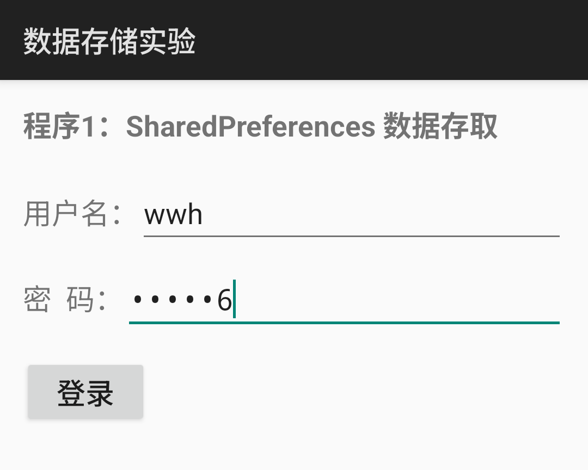
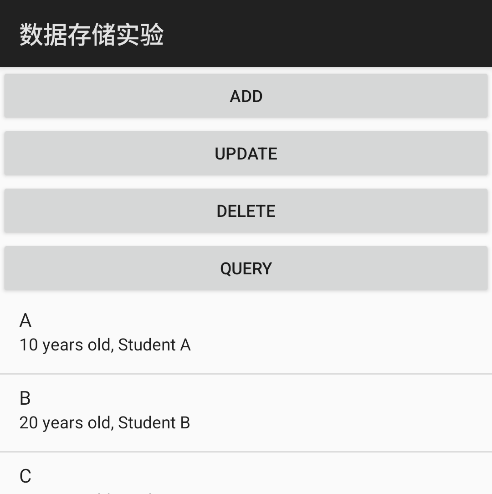
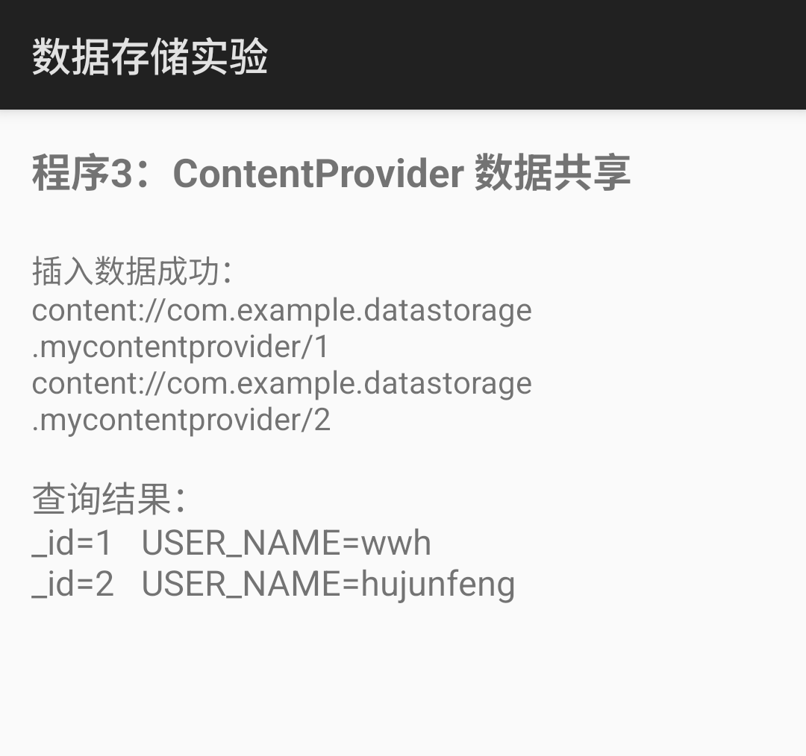

# 移动终端软件开发 · 实验二：数据存储技术

Android 数据存储实验，包含 **SharedPreferences**、**SQLite** 与 **ContentProvider** 三个程序的完整实现、运行截图和实验报告（答题卡）。

- 学生：胡俊峰
- 学号：202402323
- 实验指导书：实验二 数据存储技术

## 实验内容

| 程序 | 知识点 | 实现说明 |
| --- | --- | --- |
| 程序 1 | SharedPreferences 数据存取 | `SpMainActivity` 把用户名/密码写入 `mrsfot`，跳转 `SpReadActivity` 读取并显示 |
| 程序 2 | SQLite 数据库操作 | `DBHelper` + `DBManager` 封装建表与增删改查，`SqliteActivity` 用 ListView 显示结果 |
| 程序 3 | ContentProvider 数据共享 | `MyContentProvider` 封装 `Users.db`，客户端 `CpMainActivity` 通过 `ContentResolver` 插入并查询 |

## 运行环境

- Android Studio（项目使用 Gradle 8.11.1 + AGP 8.7.3）
- JDK 21（`gradle.properties` 中通过 `org.gradle.java.home` 指定，可按本机环境修改）
- compileSdk 35 / minSdk 24 / targetSdk 34
- 模拟器：Pixel 7（API 35，Android 15），屏幕 1080×2400

## 目录结构

```
android/Lab2DataStorage/   Android 工程源码（Java）
  app/src/main/java/com/example/datastorage/
    SpMainActivity.java  SpReadActivity.java        # 程序 1
    DBHelper.java  DBManager.java  Person.java
    SqliteActivity.java                             # 程序 2
    CpDbHelper.java  MyContentProvider.java
    CpMainActivity.java                             # 程序 3
  app/src/main/res/layout/                          # 三个程序的布局文件
screenshots/              运行截图（含报告用裁剪图 crops/）
report/                   实验报告 PDF / DOCX（答题卡）
docs/answers.md           思考题与实验小结文字
```

## 构建与运行

```bash
# 在 Android Studio 中打开 android/Lab2DataStorage 并运行 app
# 或命令行：
cd android/Lab2DataStorage
./gradlew assembleDebug

# 安装后可直接启动三个程序的入口 Activity：
adb shell am start -n com.example.datastorage/.SpMainActivity     # 程序 1（登录）
adb shell am start -n com.example.datastorage/.SqliteActivity     # 程序 2（增删改查）
adb shell am start -n com.example.datastorage/.CpMainActivity     # 程序 3（ContentProvider）
```

程序 2 的按钮顺序为 `add → update → delete → query`；程序 3 打开后自动插入 `wwh`、`hujunfeng` 并查询显示。

## 运行截图

| 程序 1：输入与读取 | 程序 2：增删改查 | 程序 3：ContentProvider |
| --- | --- | --- |
|  |  |  |

更多截图见 [`screenshots/`](screenshots/)（原始全屏截图）与 [`screenshots/crops/`](screenshots/crops/)（报告中使用的裁剪图）。

## 实验报告

- PDF：[report/实验二、数据存储技术-202402323-胡俊峰.pdf](report/实验二、数据存储技术-202402323-胡俊峰.pdf)
- 可编辑源文件：[report/实验二、数据存储技术-202402323-胡俊峰.docx](report/实验二、数据存储技术-202402323-胡俊峰.docx)

报告按答题卡原有内容填写，包含三个程序的关键代码、运行截图与标注、思考题答案及实验小结。
